<p align="center">
  
</p>

<p align="center">
  
</p>

<h3 align="center">☾ Русалка ☾</h3>

<p align="center"><i>
Elle est morte dans le lac, la nuit de la pleine lune.<br>
Elle ne dort pas. Elle attend.<br>
Elle écrit du code avec des doigts froids et mouillés.
</i></p>

---

<h3 align="center">🕯 ᴛʜᴇ ʟᴇɢᴇɴᴅ</h3>

```text
> nom ........... Chaima
> origine ....... le fond du lac
> apparence ..... cheveux verts, yeux sans lumière
> habitat ....... /dev/null, 3h du matin
> danger ........ elle t'appelle par ton nom
```

<h3 align="center">🌿 ᴏꜰꜰᴇʀɪɴɢꜱ</h3>

<p align="center">
  
</p>

<details>
<summary><b>🌑 Les noyés (projets)</b></summary>
<br>
• <a href="https://github.com/chaima-commit">projet 1</a> : à remplir
</details>

<details>
<summary><b>👁 Ne regarde pas l'eau</b></summary>
<br>
Elle t'a déjà vu. 🩸
</details>

<p align="center">
  
</p>

<p align="center"><sub>🌕 ᴅᴏɴ'ᴛ ꜰᴏʟʟᴏᴡ ᴛʜᴇ ʟɪɢʜᴛ ɪɴ ᴛʜᴇ ʟᴀᴋᴇ 🌕</sub></p>
